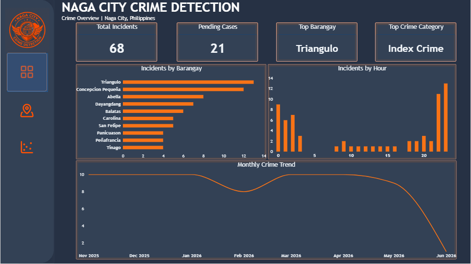
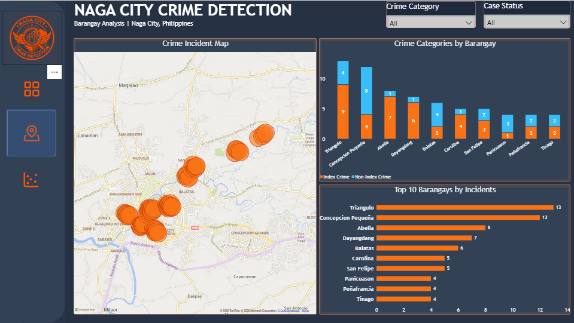
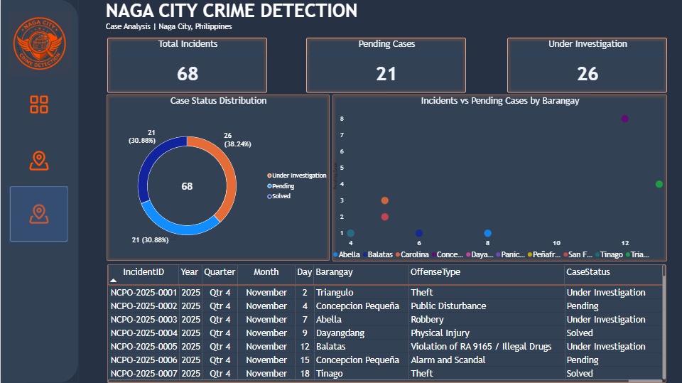

# Naga City Crime Surveillance and Prevention

A Power BI analysis of reported crime incidents in Naga City, Philippines, covering a crime overview, a barangay-level hotspot analysis, and a case status breakdown for the period **November 2025 – June 2026**.

**Tools:** Power BI · Excel · SQL (data cleaning)

---

## Overview

This project consolidates incident reports into a single governed dashboard for the Naga City police force and local government. The goal is to help decision-makers answer three practical questions:

1. **What is happening?** — incident volume, top barangays, top crime category, and time-of-day patterns.
2. **Where is it happening?** — barangay hotspots, index vs non-index crime mix, and geographic clustering.
3. **What is being done about it?** — case status distribution, pending workload, and barangay-level case backlogs.

The dashboard is organised into three pages:

| Page | Focus |
| --- | --- |
| Crime Overview | City-wide KPIs, incidents by barangay and hour, monthly trend |
| Barangay Analysis | Hotspot map, index vs non-index crime by barangay, top 10 barangays |
| Case Analysis | Case status distribution, incidents vs pending cases, incident-level table |

### Dashboard pages

*Page 1 — Crime Overview: 68 total incidents, 21 pending cases, top barangay (Triangulo) and top crime category (Index Crime).*

*Page 2 — Barangay Analysis: hotspot map and index vs non-index crime breakdown by barangay.*

*Page 3 — Case Analysis: case status distribution, incidents vs pending cases, and incident-level records.*

---

## Summary findings

### Key metrics

| Metric | Value |
| --- | ---: |
| Total incidents | 68 |
| Pending cases | 21 |
| Under investigation | 26 |
| Solved cases | 21 |
| Clearance rate (solved ÷ total) | 30.9% |
| Still open (pending + under investigation) | 69.1% |

### Incidents by barangay

| Rank | Barangay | Incidents | Share |
| ---: | --- | ---: | ---: |
| 1 | Triangulo | 13 | 19.1% |
| 2 | Concepcion Pequeña | 12 | 17.6% |
| 3 | Abella | 8 | 11.8% |
| 4 | Dayangdang | 7 | 10.3% |
| 5 | Balatas | 6 | 8.8% |
| 6 | Carolina | 5 | 7.4% |
| 7 | San Felipe | 5 | 7.4% |
| 8 | Panicuason | 4 | 5.9% |
| 9 | Peñafrancia | 4 | 5.9% |
| 10 | Tinago | 4 | 5.9% |
| | **Total** | **68** | **100%** |

### Other findings

- **Top crime category:** Index Crime (crimes against persons and property, such as theft, robbery, and physical injury).
- **Time of day:** incidents peak at **21:00–22:00**, with a secondary cluster between **00:00 and 03:00**. Activity is lowest during daytime hours (06:00–18:00).
- **Monthly trend:** the trend line stays near 10 incidents per month from November 2025 through May 2026, dips slightly in February 2026, and falls sharply in June 2026 — a pattern consistent with a partial reporting month rather than a genuine decline.
- **Crime mix:** Triangulo and Abella carry a higher share of index crimes, while Concepcion Pequeña records more non-index offenses such as public disturbance and alarm and scandal.
- **Case backlog:** 47 of 68 cases (69.1%) remain open. Under-investigation cases (26) outnumber pending cases (21), and Triangulo has the largest pending workload (≈8 cases).

---

## Insights

1. **Crime is geographically concentrated.** The top two barangays (Triangulo and Concepcion Pequeña) account for **36.8%** of all incidents. The top three reach **48.5%**, and the top five cover **67.6%**. Resources concentrated on a small number of barangays will address most of the caseload.

2. **The crime mix differs by barangay.** Triangulo's caseload is predominantly index crimes, pointing to enforcement and investigation capacity needs. Concepcion Pequeña's caseload skews toward non-index offenses, which are better addressed through visibility patrols, community mediation, and ordinance enforcement.

3. **Late evening is the highest-risk window.** The 21:00–22:00 peak, together with the midnight-to-3 a.m. activity, suggests that patrol schedules should be weighted toward the evening and early morning rather than daytime.

4. **Case resolution is the main operational bottleneck.** Only about three in ten cases are solved, and open cases (69.1%) far exceed solved ones. Because under-investigation cases outnumber pending ones, the constraint is investigative capacity rather than documentation alone.

5. **The June drop is a data signal, not a success story.** The steep decline at the end of the trend line most likely reflects incomplete data for the current month. It should be validated before being reported as a reduction in crime.

6. **High-volume barangays also carry the largest backlogs.** Triangulo leads in both incident volume and pending cases, so the same barangays that need prevention also need case-management attention.

---

## Recommendations

| Priority | Action | Rationale | Timeframe |
| --- | --- | --- | --- |
| 1 | Rebalance patrol schedules toward **20:00–23:00**, with a secondary shift at **00:00–04:00**, focused on Triangulo, Concepcion Pequeña, and Abella | Matches the observed hourly peaks and the top three barangays | Immediate |
| 2 | Triage the 26 under-investigation and 21 pending cases; assign owners and closure targets, starting with Triangulo's backlog | 69.1% of cases remain open; under-investigation cases exceed pending ones | Immediate |
| 3 | Add a **date-range slicer** and barangay drill-through; annotate partial months on the trend chart | The dashboard can only be filtered by category and status, limiting trend and hotspot analysis | 30–90 days |
| 4 | Reconcile the stacked chart segment labels with the top-10 totals (e.g., Abella) and document the aggregation logic | Chart segments do not consistently sum to the reported barangay totals | 30–90 days |
| 5 | Add **per-1,000-population rates** and an offense-level breakdown by barangay | Raw counts favour populous barangays; rates and offense mix support fairer prioritisation | 30–90 days |
| 6 | Adopt a monthly review cadence with fixed KPIs: clearance rate, average case age, incidents per 1,000 residents, % index crime, and hotspot recurrence | Turns the dashboard into a recurring management tool rather than a one-off report | Long term |
| 7 | Pair enforcement with community prevention programs in the top five barangays | Sustained reductions require demand-side and community measures, not patrols alone | Long term |

---

## Limitations and data notes

- Figures were read from the dashboard visuals and are **approximate** where labels overlap (hourly counts, stacked segments, scatter positions).
- The **stacked chart segment labels do not consistently match** the top-10 barangay totals; the summary tables use the top-10 totals, which sum to the 68-incident KPI.
- The **June 2026** point is likely a partial month and should not be interpreted as a real decline.
- The dataset has **no population denominator**, so comparisons across barangays reflect volume, not per-capita risk.
- The incident table shown covers only **November 2025** (Q4) records; the full dataset spans November 2025 – June 2026.
- The hotspot map uses cluster bubbles without a visible scale or legend, so cluster size should be validated against the barangay totals.

---

## Appendix

### Dataset fields

| Field | Description |
| --- | --- |
| IncidentID | Unique case identifier (e.g., `NCPO-2025-0001`) |
| Year / Quarter / Month / Day | Incident date attributes |
| Barangay | Barangay where the incident was recorded |
| OffenseType | Reported offense (e.g., Theft, Robbery, Physical Injury, Violation of RA 9165, Public Disturbance, Alarm and Scandal) |
| CaseStatus | Under investigation, Pending, or Solved |

### KPI definitions

- **Index crime:** Serious crimes against persons (e.g., murder, homicide, physical injury, rape) and against property (e.g., robbery, theft, carnapping).
- **Non-index crime:** Violations of special laws (e.g., illegal drugs under RA 9165) and less serious offenses (e.g., public disturbance, alarm and scandal).
- **Clearance rate:** Solved cases divided by total incidents.
- **Open cases:** Pending plus under-investigation cases.
